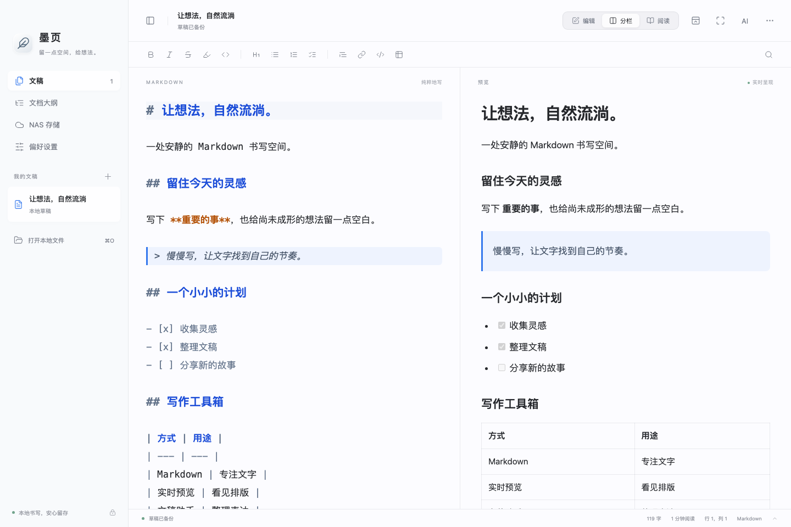
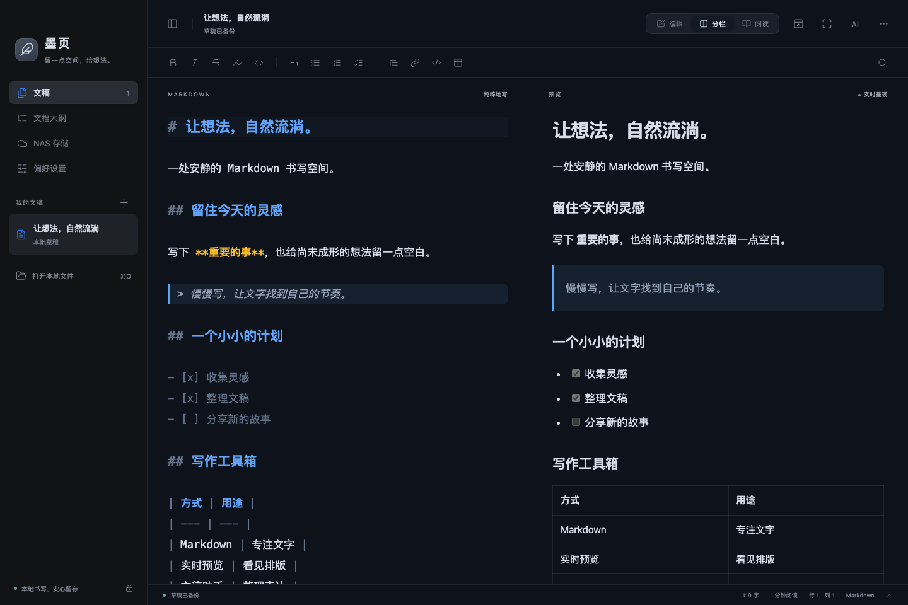
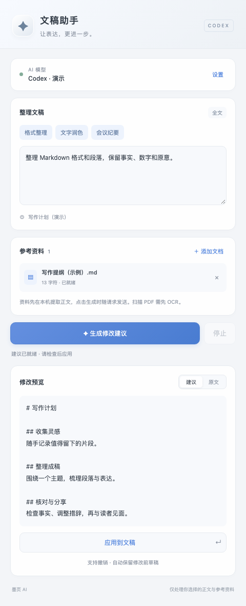

<div align="center">

# 墨页 Moye

**一处安静的 Markdown 书写空间。**

原生 macOS 窗口 · 实时预览 · Codex 文稿助手 · WebDAV 存储

[](https://github.com/einsy1/Moye/releases/latest)
[](https://github.com/einsy1/Moye/releases)
[](https://github.com/einsy1/Moye/actions/workflows/check.yml)
[](LICENSE)

[下载最新版](https://github.com/einsy1/Moye/releases/latest) · [使用说明](#开始使用) · [更新日志](CHANGELOG.md) · [反馈问题](https://github.com/einsy1/Moye/issues)

</div>



## 功能

- **Markdown 写作**：CodeMirror 6 编辑器，GFM 表格、任务列表、代码高亮、查找替换、格式快捷键、符号配对与大纲导航。
- **自由切换视图**：编辑、分栏和阅读模式；分栏同步滚动；专注与极简模式。
- **贴合 macOS**：原生窗口、文件面板、菜单和打印入口；主题、字体、字号、行号、行线与通透度设置。
- **文稿保护**：自动草稿备份、删除恢复、本地文件外部修改检测、条件保存和版本升级前备份。
- **Codex 文稿助手**：独立辅助窗口；整理选区或全文；查看原文与建议、确认应用、撤销和保留修改前草稿。
- **参考资料**：添加文字层 PDF、DOCX、Markdown、TXT；本机提取正文，生成时供 AI 参考；显示 Codex 返回的实际模型。
- **WebDAV / NAS**：浏览目录、打开文稿、ETag 条件上传、冲突保护和离线待传队列。
- **导出**：Markdown 文件、HTML、系统打印 / PDF。

## 界面

| 深色写作 | Codex 文稿助手 |
| --- | --- |
|  |  |

截图使用虚构示例文稿；助手截图中的结果与模型标识为演示数据。截图展示网页界面渲染，不含 macOS 原生窗口边框。实际应用中，助手是可移动的独立窗口。

## 下载与安装

1. 在 [Releases](https://github.com/einsy1/Moye/releases/latest) 下载 `Moye-2.0.2-macOS-arm64.zip`。
2. 解压，将 **墨页 2.0.2.app** 放入“应用程序”或自行选择的位置。
3. 打开应用；无需配置 NAS 或 AI 即可使用本地编辑功能。

**系统要求**：macOS 13 或更高版本、Apple Silicon。当前发行包仅提供 arm64。

当前应用使用本地 ad-hoc 签名，**尚未获得 Apple Developer ID 签名和公证**，系统可能阻止首次打开。请先核对来源和发布校验值，再按 macOS 的“隐私与安全性”提示处理；不要关闭系统整体安全保护。

发行页提供 SHA256SUMS。两个 ZIP 与校验文件放在同一目录后，执行 `shasum -a 256 -c SHA256SUMS`。仅下载应用时，执行 `shasum -a 256 Moye-2.0.2-macOS-arm64.zip` 并与校验文件中的同名条目比较。

## 开始使用

### 写作与保存

每次启动进入空白草稿，自动聚焦编辑器；之前的文稿和未保存内容仍保留在“我的文稿”。未编辑的空白草稿会复用，不重复累积。

“打开本地文件”下方的**历史打开**列表保留最近 30 份本地文稿，按打开时间排序、自动去重。点击会重新读取原文件，已有未保存编辑会保留；文件移动或删除时会提示读取失败。此列表是打开记录，不是文稿版本历史。

新建文稿后直接输入。草稿自动保存，正式 Markdown 文件需要使用 **⌘S** 保存。再次打开外部文件时，未修改的文稿会刷新；保存遇到外部版本变化会阻止覆盖，并提供另存副本。

| 快捷键 | 操作 |
| --- | --- |
| ⌘N / ⌘O | 新建 / 打开 |
| ⌘S / ⇧⌘S | 保存 / 另存为 |
| ⌘F | 查找替换 |
| ⌘B / ⌘I / ⌘K | 粗体 / 斜体 / 链接 |
| ⇧⌘F / ⇧⌘M | 专注 / 极简模式 |
| ⇧⌘O | 从 NAS 打开 |
| ⌘P | 打印 / PDF |

### Codex 文稿助手

1. 在本机安装并登录 Codex。墨页可自动寻找 ChatGPT.app 内置 Codex、`/opt/homebrew/bin/codex` 或 `/usr/local/bin/codex`，也可以在助手设置中填写路径。
2. 在编辑器选择一段文字，或不选择以处理全文，点击顶部 **AI**。
3. 填写要求，按需添加参考文档，点击“生成修改建议”。
4. 核对建议与原文，再点击“应用到文稿”。应用后可撤销，并保留修改前草稿；不会自动上传 NAS。

基于官方 [Codex App Server](https://learn.chatgpt.com/docs/app-server) 接入，使用本机 Codex 登录状态和账号实际额度。墨页不会要求输入账号密码，也不内置 API Key。已验证 CLI `0.166.0-alpha.6`，其他版本兼容性仍需验证。

**只有点击生成时，才会将所选正文、整理要求及已添加参考资料的提取文本发送给 Codex。** 参考文件原始路径不会作为文稿内容发送。单次正文上限 200 KB；参考文件最多 8 份、单文件 5 MB、提取正文单份 100 KB、总量约 110 KB。扫描 PDF 需先 OCR；不支持 XLSX、图片 OCR 或保留附件原版式。

本版采用每次独立生成，不提供跨请求聊天记忆。模型默认跟随 Codex 配置，生成时显示实际返回的模型；指定模型是否可用取决于账号权限。

### NAS / WebDAV

在“NAS 存储”填写 WebDAV 服务地址、相对目录、账号和密码，例如 `https://nas.example.com:5006`。请填写 WebDAV 服务入口，不是 NAS 管理后台。可先测试连接、浏览目录，再保存配置。

默认使用 HTTPS；HTTP 需主动开启。密码由 macOS 钥匙串保存。首次上传避免覆盖同名文件，更新使用强 ETag；远端变化会暂停覆盖。应用运行期间会重试临时失败，退出后不运行后台同步。这是文稿存取和补传功能，**不属于完整双向云盘同步**。

## 数据与隐私

- 本地编辑与预览无需联网；预览禁止自动加载远程图片。
- 草稿、旧快照及删除归档以明文保存在本机。NAS 非密码配置保存在本机配置文件，密码保存在钥匙串。
- AI 生成和 NAS 存取会按你发起的操作连接相应服务；Codex 自身的数据处理和权限行为由其版本、配置与账号政策决定。
- 仓库和发行包不包含个人文稿、NAS 地址或账号、钥匙串、登录令牌及本地调试记录。

更多见 [隐私说明](PRIVACY.md) 和 [升级与回滚](ROLLBACK.md)。

## 从源码构建

需要 macOS、Xcode Command Line Tools（Swift、SDK、iconutil、codesign）、Node.js 22+ 和 npm。

```sh
git clone https://github.com/einsy1/Moye.git
cd Moye
npm ci
./build.sh
```

产物为 `dist/墨页 2.0.2.app`。脚本只构建当前版本，不替换旧版本应用。第三方许可证自动复制到应用 `Contents/Resources/Licenses`。

### 测试

```sh
npx playwright install chromium
npm test
npm run test:markdown
npm run test:bridge
npm run test:regressions
npm run test:assistant
npm run test:native
npm run test:titlebar
```

`npm run screenshots` 可用虚构数据重新生成 README 展示图，不调用 AI 服务。

`npm run test:ai` 是可选的真实 Codex 测试，需要有效登录，会发送构造的测试文本并可能消耗账号额度；CI 不执行该测试。

## 项目结构

```text
Sources/      AppKit、WKWebView、文件存储、WebDAV 与 Codex 桥接
web/          Markdown 编辑器及独立 AI 助手界面
scripts/      许可证收集与本地发行打包
tests/        编辑器、消息桥、存储、网络与助手回归
docs/         示例截图和发行说明
```

## 已知边界

- 尚未进行 Intel、全部 macOS 版本或真实 NAS 的完整验收。
- 超长文稿、巨量草稿以及批量粘贴仍需进一步性能优化；打开文件上限 10 MB。
- AI 建议需要用户核对，不保证保留全部事实或满足所有格式要求；应用前会校验文稿版本。
- 独立助手在屏幕空间足够时与编辑器并排；极窄屏幕需手动调整窗口位置。
- PDF/DOCX 提取主要用于获取正文，复杂版式、表格和扫描文档可能不完整。
- 没有自动更新、插件系统或附件图片管理。

## 参与项目

欢迎提交问题和改进建议。请先阅读 [贡献指南](CONTRIBUTING.md)。报告问题时使用脱敏示例，不要附带真实文稿、NAS 凭据或 Codex 登录文件。

## 许可与致谢

墨页采用 [MIT License](LICENSE)。第三方组件保留各自许可证，见 [第三方说明](THIRD_PARTY_NOTICES.md)。

感谢 [CodeMirror](https://codemirror.net/)、[Marked](https://github.com/markedjs/marked)、[DOMPurify](https://github.com/cure53/DOMPurify)、[Lucide](https://lucide.dev/) 和 [OpenAI Codex](https://github.com/openai/codex)。功能设计参考 [MarkEdit](https://github.com/MarkEdit-app/MarkEdit)。本项目不是 OpenAI 官方产品。

本项目由作者主导设计和开发，使用 Codex、Google Antigravity 等 AI Agent 辅助编码、优化与迭代。工具参与开发不代表其厂商对本项目提供背书；运行时依赖与许可证见第三方说明。
